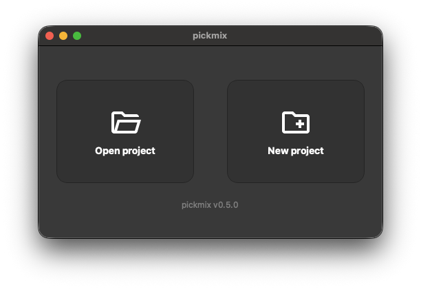
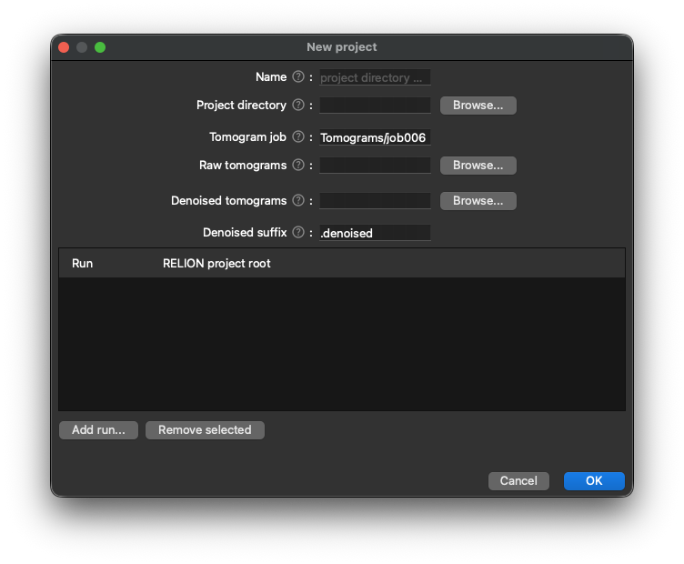
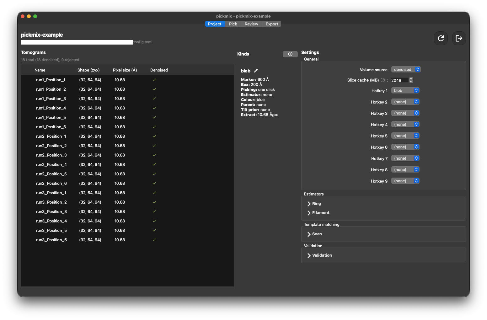
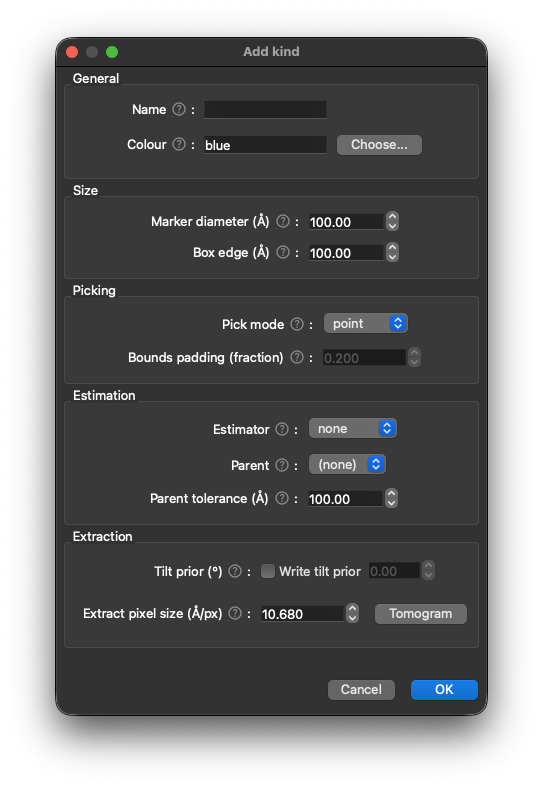
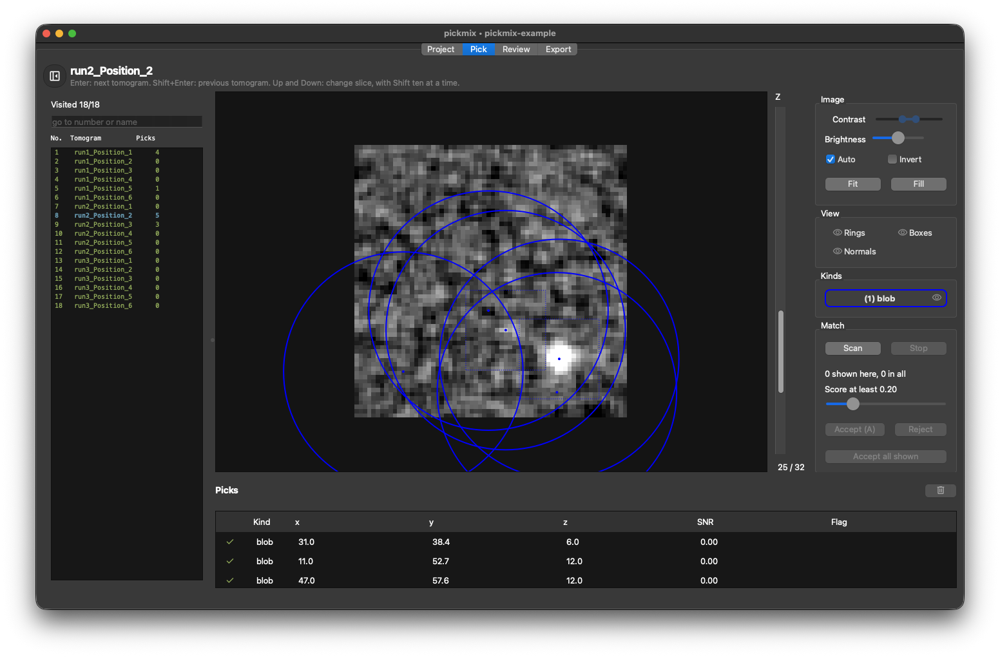
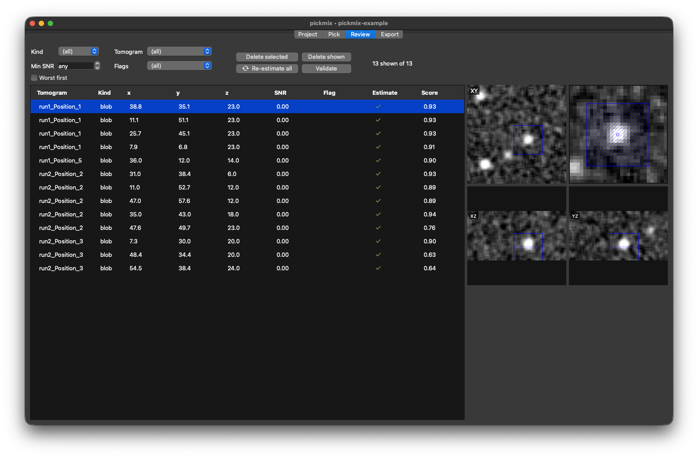
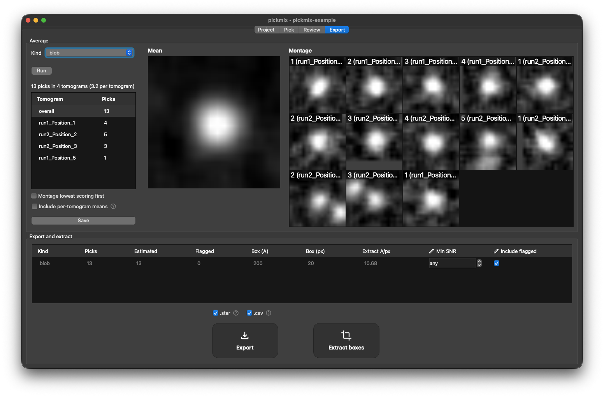

# pickmix

Multi-kind particle picking GUI for cryo-ET sub-tomogram-averaging workflows.

Pickmix supports picking multiple kinds of user-defined particles from reconstructed tomograms, with built-in SNR-based refinement estimation and a 2D average validation step, for export as a RELION 5-compatible coordinate `.star` file.

## Installation
### Requirements
- Python (≥3.14)
- [`uv`](https://docs.astral.sh/uv/) package manager

### Installation command

```sh
uv tool install git+https://github.com/holsam/pickmix
pickmix [path/to/config.toml]
```
For development, use `uv sync` then `uv run pickmix`.

## Inputs

- One or more RELION projects. Each project must have a tomogram job (default `Tomograms/job006`) which contains a `tomograms.star`.
- Reconstructed tomograms. All raw tomograms should be located (symbolic linking is supported) within a single directory as MRC files. The header shape and pixel size of each MRC file must agree with `tomograms.star`, otherwise the tomogram will be rejected.
- [OPTIONAL] Denoised tomograms. All denoised tomograms should be located (symbolic linking is supported) within a single directory as MRC files. Denoised tomograms can contain an additional specified suffix (e.g. `.denoised`) that will be included when matching to raw tomograms.

## How to use `pickmix`
### 1. Create a project

Launch pickmix using `pickmix`. The welcome page has two buttons for opening an existing project (also via `Ctrl/Cmd+O`) and creating a new project (also via `Ctrl/Cmd+N`).



Click `[New project]`, and complete the fields in the dialog. Hover over a field's `(?)` for further information about each field. Pickmix merges all the entered runs into a single `tomograms.star` and writes `config.toml` in the project directory. Tomogram names get the run name as a prefix. Existing files are never overwritten.



### 2. Check the project and define kinds

`pickmix` will now open to the Project tab, which contains the three columns described below. 



#### 2.1 Tomograms
This table lists every tomogram alongside its shape, pixel size and whether a matching denoised volume was identified. Yellow warnings indicate usable tomograms with issues to be aware of (e.g. no denoised tomogram found, unusual pixel size), while a red error marks a rejected or unusable tomogram - hover over the error to see the reaon.

#### 2.2 Kinds
Each 'kind' is a type of pick and multiple can be added as required. Each kind has a marker size, an extraction box, an estimator (`ring` fits a circle to a pick, `filament` snaps a pick onto a dark filament, `none` passes the click straight through), a pick mode, a colour, an optional parent kind and an extraction pixel size. A kind with a parent takes its membrane-normal orientation from the nearest parent estimate.



##### 2.2.1 `filament` estimator
The `filament` estimator finds the nearest dark filament, moves the pick onto its axis, and measures width, in-plane direction and z-extent. The pick's box can be sized one of two ways which is defined by `Box from`, each with different uses:

`Box from` value | Box size derived from | Description
-- | -- | --
`segment` (default) | The length of the filament | The box is large and mostly empty other than a thin filament, but useful for when the full filament is needed for further refinement
`width` | The width of the filament multiplied by a margin | The box is small but a single filament may be split into tiled particles along the axis

##### 2.2.2 `bounds` pick mod
A kind with the `bounds` pick mode is picked using two clicks, one on each side of the particle. The pick centre is then derived from the centre of the line linking the two click points, with box edge derives from this distance plus the kind's configured padding. Extraction and averaging use one box for a kind, therefore leave `Box edge` at 0 to derive this length from the 95th percentile of the picks' boxes.

#### 2.3 Settings
This pane controls general settings for the project, including which volume to use in the picking interface and which hotkeys map to which kinds. Parameters for the `ring` and `filament` estimators, and for kind validation, can also be adjusted here as required.

### 3. Pick
Open the Pick tab. To the left is a a list of tomograms in the project, clicking a tomogram will jump there as will typing either its name or number into the search bar (the search bar automatically moves to the first match). If needed, the tomogram list can be hidden using the button next to the tomogram title. Select a kind using a hotkey or from the Kinds group, and left-click to add or select a pick. Picks can be moved by selecting & dragging, or deleted using the delete button (or `Delete` key). Right-click to pan across the current slice, and Ctrl/Cmd+Scroll to adjust zoom. Scrolling updates the current Z slice, as do the `Up`/`Down` arrow keys (`Shift` for ten slices at a time), and `Enter`/`Shift+Enter` steps forward/backward between tomograms. For a two-click kind, click one side of the structure then the other (`Esc` cancels). The settings pane has brightness/contrast controls, including `Auto` (the tomogram's own limits) and `Invert`, as well as auto-zoom functions `Fit` and `Fill`. The views group shows/hides fitted rings and filament axes, boxes and normals. The pick table beneath shows each pick's estimate status: a green tick, a yellow warning (when flagged), a red error (when error occured during estimation), or a blue spinner (during processing).



#### 3.1 Template matching
Once several picks exist for a kind, the Match group within the settings pane can be used to identify potential candidates. Click `Scan` to generate an average pick and search unvisited tomograms for matches, which will appear as dotted markers on tomograms and in the pick table with a blue status icon. Click a candidate to select it, then press either `Accept` (or hotkey `a`) to convert it into a pick, or `Reject` (or either hotkey `delete`/`backspace`) to hide it. Currently this search is not rotation aware, so best suits symmetric particles. Setting for template matching can be edited in the project tab within the settings tab.

### 4. Review

Open the Review tab. Picks can be filtered by kind, tomogram, minimum SNR and whether they were flagged, with options to delete the selected pick or all currently shown. All picks can be queued for re-estimation here if required as well. Single-click a pick to view XY/XZ/YZ previews as well as a close-up patch. The pick's box is outlined in every panel, with the z range of its fit dotted in XZ and YZ, and a filament's axis is drawn in the patch. Drag the dot or the box in the patch to nudge the pick position and trigger re-estimation. Double-click a pick to open it in the Pick tab. `Validate` scores each pick of the chosen kind (all if none is chosen) against the average of its kind, taken over small shifts and without the lowest scoring picks, and flags picks scoring far below the rest as `lowcc`. Clean kinds won't be flagged, and the cut-off can be adjusted in Settings as required. The scores show in a `Score` column and `Worst first` orders by them.



### 5. Average and export

Open the Export tab. At the top, the averaging pane allows selection of a kind to build a mean projection and montage of the picks for that kind (optionally filterable by tomogram). Filaments are turned along x before they are averaged, with their two ends not told apart. `Montage lowest scoring first` fills the montage with the lowest validation scores. The mean and montage images can be saved to `out/` from here, as well as per-tomogram extracted picks if desired. Below, a table summarises the collected data for all kinds and allow specification of a minimum SNR and whether to include flagged picks in exports. Click the checkboxes for the desired output filetype(s) and click `Export` to save. `Extract` alternatively generates a subvolume from each pick and saves as MRC files under `out/particles/<kind>`.



## Project layout

```
project/
  config.toml        settings and kinds
  tomograms.star     merged RELION tomogram table
  tilt_series/       one star file per tomogram
  out/               picks, candidates, estimates, validation scores, averages, RELION & .csv exports
```
