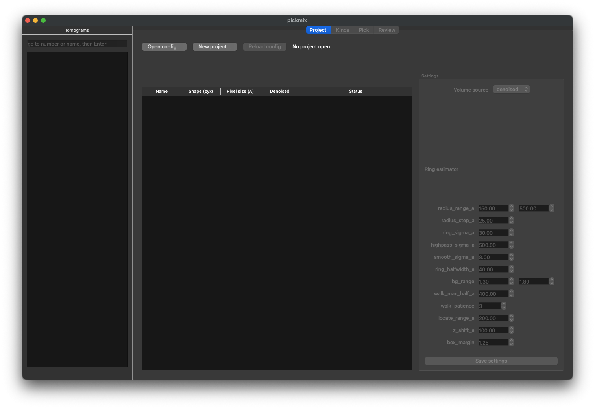
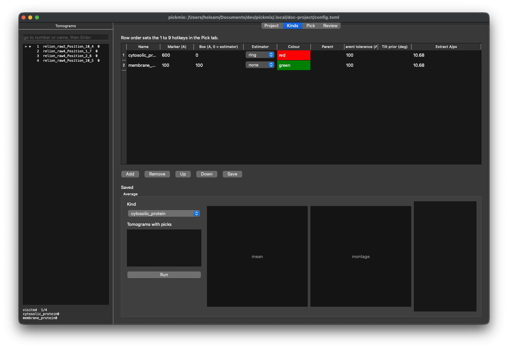
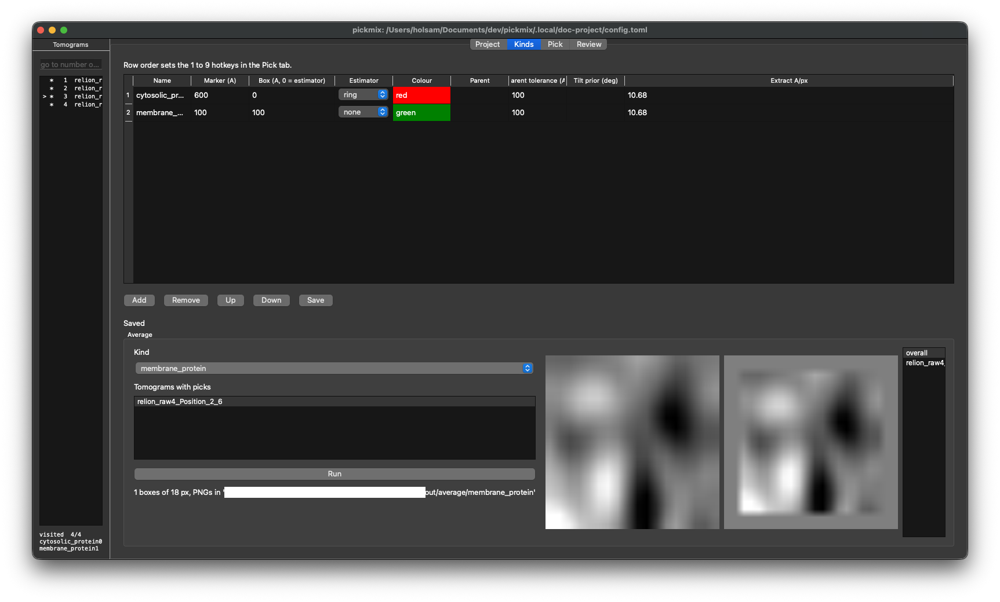

# pickmix

Multi-kind particle picking GUI for cryo-ET sub-tomogram-averaging workflows.

Pickmix supports picking multiple kinds of user-defined particles from reconstructed tomograms, with built-in SNR-based refinement estimation and a 2D average validation step, for export as a RELION 5-compatible coordinate `.star` file.

## Installation
### Requirements
- Python (≥3.14)
- [`uv`](https://docs.astral.sh/uv/) package manager

### Installation command

```sh
uv tool install git+https://github.com/holsam/pickmix
pickmix [path/to/config.toml]
```
For development, use `uv sync` then `uv run pickmix`.

## Inputs

- One or more RELION projects. Each project must have a tomogram job (default `Tomograms/job006`) which contains a `tomograms.star`.
- Reconstructed tomograms. All raw tomograms should be located (symbolic linking is supported) within a single directory as MRC files. The header shape and pixel size of each MRC file must agree with `tomograms.star`, otherwise the tomogram will be rejected.
- [OPTIONAL] Denoised tomograms. All denoised tomograms should be located (symbolic linking is supported) within a single directory as MRC files. Denoised tomograms can contain an additional specified suffix (e.g. `.denoised`) that will be included when matching to raw tomograms.

## How to use `pickmix`
### 1. Create a project

Launch pickmix using `pickmix`, which will open on the Project tab.



Click `[New project]`, and complete the fields in the dialog. Pickmix merges multiple runs into a single `tomograms.star` and writes `config.toml` in the project directory. Tomogram names get the run name as a prefix. Existing files are never overwritten.


Once created, the Project tab lists usable and rejected tomograms and the shared settings.


### 2. Define kinds

Open the Kinds tab, and add additional 'kinds' (types of pick) as required. Each kind has a marker size, an extraction box, an estimator (`ring` fits a circle to a pick, `none` passes the click straight through), a colour, an optional parent kind and an extraction pixel size. The table order sets the `1` to `9` hotkeys. A kind with a parent takes its membrane-normal orientation from the nearest parent estimate.



### 3. Pick

Open the Pick tab and select a kind with `1` to `9`. Left-click adds or selects a pick; picks can be moved by selecting & dragging, or deleted using `Delete`. Right-click to pan across the current slice, and Ctrl/Cmd+Scroll to adjust zoom. Scrolling updates the current Z slice, and `Enter`/`Shift+Enter` steps forward/backward between tomograms. Fitted rings, boxes and normals can be toggled on/off as desired, and contrast sliders adjust the display.


### 4. Average

Return to the Kinds tab, and select a kind. Click `[Run averaging]` to extract a box around each pick and create a mean projection & montage.



### 5. Review and export

Open the Review tab. Picks can be filtered by SNR and any flags, delete flagged picks, re-estimate, then **Export star files** to write `out/relion/<kind>/particles.star` plus one `NAME_coords.star` per tomogram. **Extract boxes** cuts the sub-volumes as MRC files. Kinds with a parent also write the subtomogram angles derived from it.


## Project layout

```
project/
  config.toml        settings and kinds
  tomograms.star     merged RELION tomogram table
  tilt_series/       one star file per tomogram
  out/               picks, estimates, averages, RELION export
```
